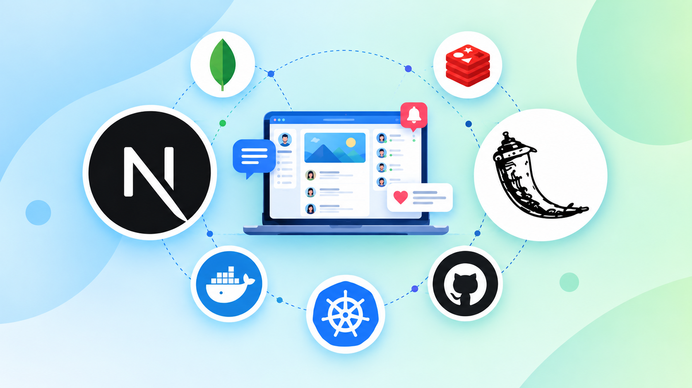
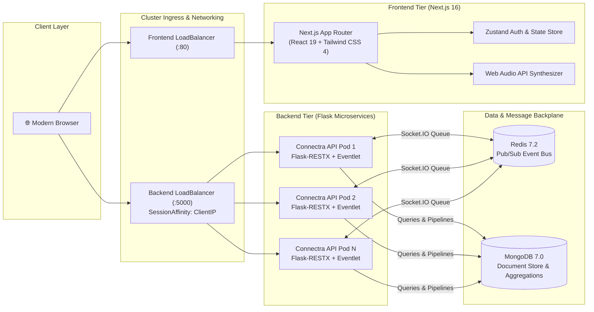
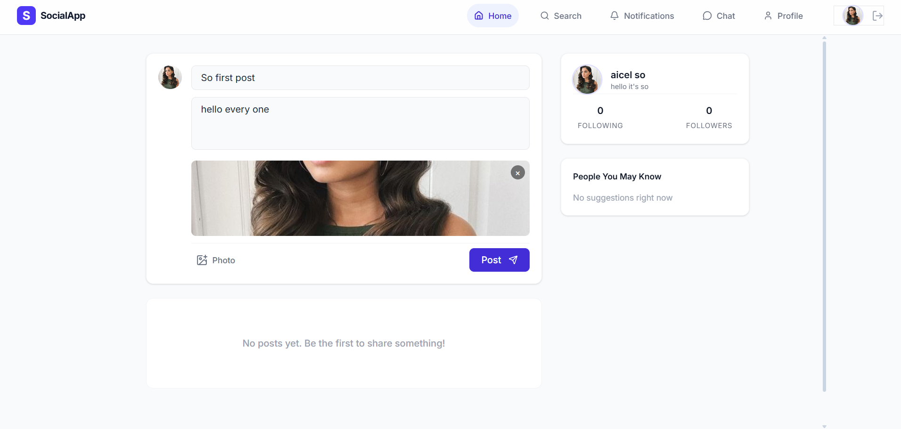
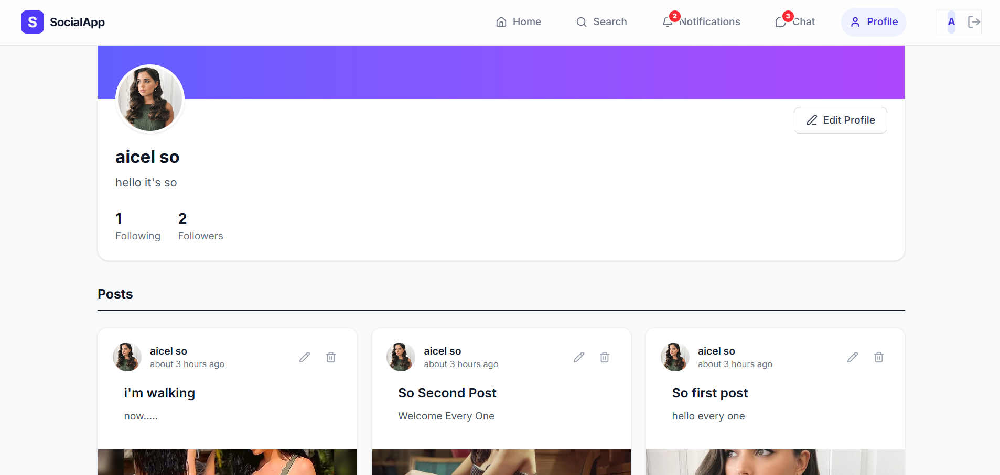
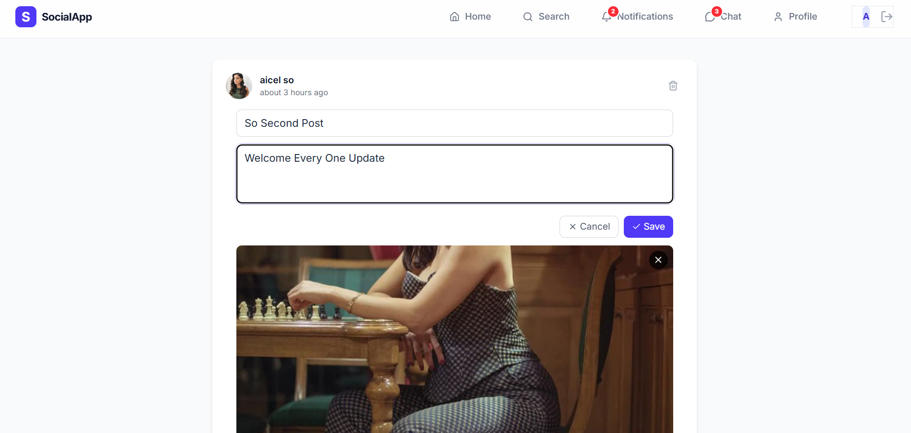

<div align="center">



# Connectra

### Next-Generation Distributed Real-Time Social Platform

[](https://nextjs.org/)
[](https://react.dev/)
[](https://tailwindcss.com/)
[](https://flask.palletsprojects.com/)
[](https://flask-socketio.readthedocs.io/)
[](https://www.mongodb.com/)
[](https://redis.io/)
[](https://www.docker.com/)
[](https://kubernetes.io/)
[](https://github.com/features/actions)

<p align="center">
  A cloud-native, real-time social networking platform featuring distributed WebSocket messaging, reactive live feeds, online presence detection, and event-driven architecture powered by Next.js 16, Python Flask, Redis Pub/Sub, MongoDB, and Kubernetes.
</p>

</div>

---

## 📌 Executive Architecture Summary

**Connectra** is engineered as a decoupled, horizontally scalable full-stack social network. It solves the classic multi-instance WebSocket coordination challenge: when multiple application pods serve concurrent WebSocket clients, Redis Pub/Sub acts as the centralized inter-process communication (IPC) message queue, ensuring private messages, typing events, and notifications route seamlessly across pod boundaries.



---

## 🚀 Key Architectural Modules & Technical Highlights

### 1. Distributed Real-Time Gateway (Flask-SocketIO + Redis Pub/Sub)
- **Multi-Pod Event Sync**: Socket.IO instances across replica pods broadcast through Redis pub/sub messaging queues, allowing users connected to separate Kubernetes pods to communicate in real time without connection dropouts.
- **Bi-directional Direct Messaging**: Persistent one-on-one instant messaging with message history pagination, auto-scroll synchronization, and dynamic unread message count badges.
- **Presence & Connection Lifecycles**: Automatic tracking of active connections, broadcasting `onlineFriends`, `friendConnected`, and `friendDisconnected` state changes to mutual connections.

### 2. High-Performance Social Feed & Aggregation Pipelines
- **Social Graph Feed Delivery**: Dynamic feed querying that pulls posts from followed users and the current authenticated user in reverse chronological order.
- **MongoDB Aggregation Pipelines**: Multi-stage aggregation `$lookup` pipelines to join comments, resolve author profile metadata, and compute like tallies within a single roundtrip query.
- **Interactive Multimedia**: In-browser post authoring with Base64 image compression, real-time like toggles, inline comment threads, and post lifecycle editing/deletion.

### 3. Modern Next.js 16 Frontend
- **App Router & Turbopack**: High-efficiency server/client component separation with sub-second compilation times.
- **Zustand State Engine**: Synchronized state management coordinating authentication tokens, cookies, and localStorage for instant hydration and zero-flicker protected route enforcement.
- **Zero-Dependency Web Audio Synthesis**: Direct browser Web Audio API oscillator synthesis generating crisp chime tones for incoming messages and alerts without external audio assets.

### 4. Cloud-Native Kubernetes Infrastructure
- **Zero-Downtime Rolling Updates**: Configured with `maxSurge: 1` and `maxUnavailable: 0` for seamless deployment rollouts.
- **Probes & Resilience**: HTTP readiness (`/docs`) and liveness probes guaranteeing self-healing pod recovery.
- **Resource Governance**: Explicit CPU and Memory request/limit boundaries to ensure predictable multi-tenant cluster performance.

---

## 🛠️ Complete Tech Stack

| Domain | Technologies |
| :--- | :--- |
| **Frontend Framework** | **Next.js 16.3** (App Router, Standalone Output), **React 19.2**, **TypeScript 5** |
| **Styling & UI** | **Tailwind CSS 4**, Lucide React, Glassmorphism Backdrop Blurs |
| **Client State & Comms** | **Zustand 5**, Axios (JWT Interceptor Pipeline), Socket.IO Client 4.8, Web Audio API |
| **Backend Framework** | **Python 3.14**, **Flask 3.1**, **Flask-RESTX** (OpenAPI / Swagger at `/docs`) |
| **Real-Time Engine** | **Flask-SocketIO 5.6**, **Eventlet 0.41**, Python-EngineIO |
| **Databases** | **MongoDB 7.0** (PyMongo, Motor), **Redis 7.2** (Pub/Sub Queue) |
| **Security & Auth** | **JWT** (JSON Web Tokens via PyJWT), **Passlib + Bcrypt** Password Hashing |
| **Testing** | **Pytest 9.1** (Unit & Integration via `mongomock`), **Playwright 1.64** (E2E) |
| **Containerization & K8s** | **Docker** (Multi-stage runner), **Kubernetes** (Deployments, Services, ConfigMaps, PVC) |
| **CI/CD Automation** | **GitHub Actions** (Automated Test Execution, Docker Buildx, Tagged Container Registry Push) |

---

## 📸 Interface Preview

<div align="center">

### Home Feed & Interactive Creation


### Post Management & Inline Editing


### User Profiles & Social Graph


### Post Details & Timeline Updates


</div>

---

## 📡 REST API & Socket Route Reference

### Authentication & User Namespace (`/user`)
| Method | Endpoint | Description | Auth Level |
| :--- | :--- | :--- | :--- |
| `POST` | `/user/signup` | Registers new user, hashes password via bcrypt, issues JWT | Public |
| `POST` | `/user/signin` | Validates credentials and returns JWT bearer token | Public |
| `GET` | `/user/getUser` | Retrieves user profile by ID, optional post timeline hydration | Public |
| `PATCH` | `/user/Update/<id>` | Updates profile metadata (bio, display name, avatar) | `Bearer JWT` (Owner) |
| `PATCH` | `/user/<id>/following` | Toggles follow/unfollow status atomically across both user documents | `Bearer JWT` |
| `GET` | `/user/getSug` | Computes friend recommendations based on un-followed connections | Public |

### Posts & Interactions Namespace (`/posts`)
| Method | Endpoint | Description | Auth Level |
| :--- | :--- | :--- | :--- |
| `POST` | `/posts` | Publishes a new post with optional Base64 image payload | `Bearer JWT` |
| `GET` | `/posts` | Paginated feed retrieving user's posts and followed users' posts | Public |
| `GET` | `/posts/<id>` | Retrieves detailed post document with aggregated comments | Public |
| `PATCH` | `/posts/<id>` | Edits title and description of an existing post | `Bearer JWT` (Creator) |
| `DELETE` | `/posts/<id>` | Deletes post and triggers cascade removal of attached comments | `Bearer JWT` (Creator) |
| `GET` | `/posts/search` | Regex full-text query across post titles and creators | Public |
| `PATCH` | `/posts/<id>/likePost` | Toggles like status and emits real-time notification to post creator | `Bearer JWT` |

### Comments Namespace (`/comment`)
| Method | Endpoint | Description | Auth Level |
| :--- | :--- | :--- | :--- |
| `POST` | `/comment/<id>` | Appends a comment to post `<id>` and sends instant notification | `Bearer JWT` |
| `DELETE` | `/comment/<id>` | Removes specified comment by ID | `Bearer JWT` (Creator) |

### Real-Time Chat Namespace (`/chat`)
| Method | Endpoint | Description | Auth Level |
| :--- | :--- | :--- | :--- |
| `POST` | `/chat/sendmessage` | Dispatches direct message and updates unread message tallies | Public |
| `GET` | `/chat/getmsgsbynums` | Fetches cursor-paginated chat history between two user IDs | Public |
| `GET` | `/chat/get-user-unreadedmsg` | Fetches unread message counters grouped by interlocutor | Public |
| `POST` | `/chat/mark-msg-asreaded` | Marks unread messages as read between two user IDs | Public |

### Notifications Namespace (`/notification`)
| Method | Endpoint | Description | Auth Level |
| :--- | :--- | :--- | :--- |
| `GET` | `/notification/<userid>` | Retrieves user notification stream with aggregated sender profiles | Public |
| `PATCH` | `/notification/mark-notification-asreaded` | Marks a specific notification as read | Public |

### Real-Time WebSocket Events (Socket.IO)
| Event | Direction | Payload | Description |
| :--- | :---: | :--- | :--- |
| `connect` | Client → Server | — | Establishes persistent WebSocket session |
| `setUserId` | Client → Server | `userId: string` | Binds socket session to user ID; dispatches presence |
| `onlineFriends` | Server → Client | `string[]` | Emits active friend IDs currently online |
| `friendConnected` | Server → Client | `{ connectedUserId: string }` | Broadcasts user online event to mutual connections |
| `friendDisconnected` | Server → Client | `{ disconnectedUserId: string }` | Broadcasts user disconnect to mutual connections |
| `privateMessage` | Bi-directional | `{ toUserId, message }` | Direct real-time message routing |
| `receiveNotification`| Server → Client | `Notification` | Real-time push alert for likes and comments |

---

## 📂 Repository Directory Tree

```text
Connectra/
├── .github/
│   └── workflows/
│       └── ci-cd.yml             # Automated multi-stage GitHub Actions pipeline
├── backend/
│   ├── DB/
│   │   └── database.py           # MongoDB connection lifecycle & database resolution
│   ├── auth/
│   │   ├── auth_bearer.py        # Token-required decorator & header validation
│   │   └── auth_handler.py       # JWT creation, signing, and verification
│   ├── interfaces/               # Flask-RESTX Swagger OpenAPI namespaces & model schemas
│   │   ├── chat_interfaces.py
│   │   ├── notify_interfaces.py
│   │   ├── post_interfaces.py
│   │   └── user_interfaces.py
│   ├── models/                   # Pydantic data schemas
│   │   ├── comment_model.py
│   │   ├── message_model.py
│   │   ├── notification_model.py
│   │   ├── posts_model.py
│   │   ├── unReadedmsg_model.py
│   │   └── users_model.py
│   ├── router/                   # REST controller endpoints
│   │   ├── chat.py
│   │   ├── comments.py
│   │   ├── notify.py
│   │   ├── posts.py
│   │   └── user.py
│   ├── services/                 # Business logic, aggregation pipelines & DB interactions
│   │   ├── chatService.py
│   │   ├── notifyService.py
│   │   ├── postService.py
│   │   └── userService.py
│   ├── tests/                    # Comprehensive Pytest test suite
│   │   ├── conftest.py           # Test fixtures, mock mongo & test client config
│   │   ├── integration/          # API route integration tests
│   │   └── unit/                 # Model validation & auth logic unit tests
│   ├── app.py                    # Application entry-point, CORS, RESTX & Socket.IO init
│   ├── extensions.py             # Shared Socket.IO and connection state extensions
│   ├── socket_events.py          # WebSocket event handlers (presence, messaging, rooms)
│   ├── Dockerfile                # Production Python 3.14 slim container manifest
│   ├── pytest.ini                # Pytest configuration settings
│   └── requirements.txt          # Python dependencies
├── frontend/
│   ├── app/                      # Next.js 16 App Router pages
│   │   ├── auth/page.tsx         # Login & registration portal
│   │   ├── chat/page.tsx         # Live WebSocket direct chat page
│   │   ├── notifications/        # User notifications center
│   │   ├── posts/[id]/           # Deep-link post detail view
│   │   ├── profile/[id]/         # User profile & authored post gallery
│   │   ├── search/page.tsx       # Live user and post search
│   │   ├── layout.tsx            # Global layout, fonts, and provider wrappers
│   │   └── page.tsx              # Main aggregated home timeline
│   ├── components/
│   │   ├── layout/               # Navigation, sticky sidebars & menus
│   │   ├── providers/            # SocketProvider, AuthGuard, Root Providers
│   │   └── ui/                   # Reusable components (PostCard, Modals)
│   ├── lib/
│   │   ├── api.ts                # Axios client with auto-injecting JWT interceptors
│   │   ├── posts.ts              # Post creator hydration helpers
│   │   ├── sounds.ts             # Web Audio API chime tone synthesizer
│   │   └── store/                # Zustand global authentication state store
│   ├── e2e/                      # Playwright end-to-end test scenarios
│   ├── types/                    # TypeScript data definitions
│   ├── Dockerfile                # Multi-stage Next.js standalone runner container
│   ├── next.config.ts            # Next.js standalone output configuration
│   ├── package.json              # Frontend dependencies and npm scripts
│   └── tsconfig.json             # TypeScript compiler settings
├── k8s/                          # Production Kubernetes manifests
│   ├── backend/                  # Backend deployment, service, and configmap
│   ├── frontend/                 # Frontend deployment, service, and configmap
│   ├── mongodb/                  # MongoDB deployment, persistent volume claim, service
│   ├── redis/                    # Redis pub/sub deployment and service
│   └── namespace.yaml            # Isolated `connectra` cluster namespace
├── docs/
│   └── images/                   # Architecture diagrams and UI preview assets
├── .env.example                  # Environment variable reference template
├── .gitignore                    # Comprehensive repository exclusions
├── deploy.bat                    # Automated deployment helper for release tags
├── run-local-k8s.bat             # Single-command local Kubernetes deployment
├── run_test.sh                   # Unified test suite runner (Unix / macOS)
├── run_tests.ps1                 # Unified test suite runner (Windows PowerShell)
└── stop-k8s.bat                  # Kubernetes cluster teardown script
```

---

## ⚡ Quickstart & Local Setup

### Prerequisites
- **Node.js** >= 20.x
- **Python** >= 3.11 (Python 3.14 recommended)
- **MongoDB** running on `localhost:27017`
- **Redis** running on `localhost:6379`

### 1. Clone the Repository
```bash
git clone https://github.com/pankaj-raikar/Connectra.git
cd Connectra
```

### 2. Configure Environment Variables
```bash
# Root
cp .env.example .env

# Backend
cp backend/.env.example backend/.env

# Frontend
cp frontend/.env.example frontend/.env.local
```

### 3. Backend Setup
```bash
cd backend
python3 -m venv env
source env/bin/activate    # On Windows: env\Scripts\activate
pip install -r requirements.txt pytest-mock
python app.py
```
Backend API will start on **http://localhost:5000** (OpenAPI documentation available at **http://localhost:5000/docs**).

### 4. Frontend Setup
```bash
cd ../frontend
npm install
npm run dev
```
Open **http://localhost:3000** in your browser.

---

## ☸️ Kubernetes Deployment

Deploy the entire microservice stack (MongoDB, Redis, Backend Replicas, Frontend Replicas) with zero hassle:

```bash
# 1. Apply namespace
kubectl apply -f k8s/namespace.yaml

# 2. Deploy persistence & message brokers
kubectl apply -f k8s/mongodb/
kubectl apply -f k8s/redis/

# 3. Deploy application microservices
kubectl apply -f k8s/backend/
kubectl apply -f k8s/frontend/

# 4. Monitor rollout status
kubectl rollout status deployment/backend -n connectra
kubectl rollout status deployment/frontend -n connectra
```

To stop and tear down all cluster resources:
```bash
kubectl delete namespace connectra
```

---

## 🧪 Testing Suites

Connectra enforces complete test coverage across backend units, integration routes, and frontend browser user journeys:

### Run All Tests via Unified Runner
```bash
chmod +x run_test.sh
./run_test.sh
```

### Run Backend Tests Separately (Pytest)
```bash
cd backend
python -m pytest tests/ -v
```

### Run Frontend E2E Scenarios Separately (Playwright)
```bash
cd frontend
npm run test:e2e
```

---

## 👨‍💻 Author

**Pankaj Raikar**
- **GitHub**: [@pankaj-raikar](https://github.com/pankaj-raikar)
- **Email**: [pankajraikar6@gmail.com](mailto:pankajraikar6@gmail.com)

---

## 📄 License
This project is licensed under the [MIT License](LICENSE).
